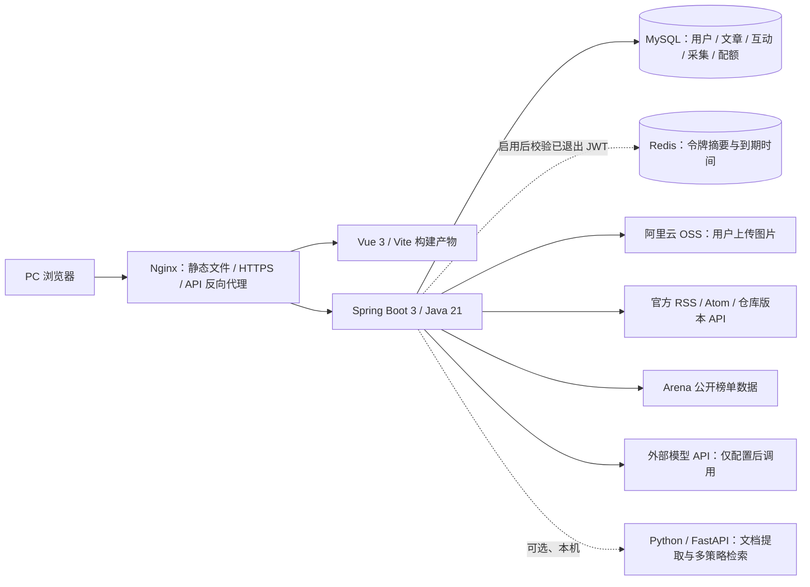

# BOOM 大事件：架构与演示路线

本页是项目当前的面试入口。后端仓库为 `big-event`，前端仓库为 [big-event-web](https://github.com/Wkey999/big-event-web)，目前持续开发的分支：后端 `master`，前端 `main`。项目面向 PC Web，移动端适配不属于当前初版目标。

## 一句话介绍

BOOM 是一个前后端分离的内容社区。用户可以浏览、检索、创作和互动；后台从限定的官方 RSS/Atom 与官方仓库版本源收录链接卡片；AI 助手通过只读工具查询已发布文章；模型榜单展示外部测评数据，不自行编造分数。

## 系统结构

浏览器请求以 `/api` 开头；开发环境由 Vite 代理剥离此前缀，服务器由 Nginx 反向代理剥离。Vue Router 使用 History 模式，页面刷新由 Nginx 回退到 `index.html`；缺失的静态资源仍返回 404。后端和 MySQL 只在服务器本机监听，不对公网开放业务端口。

## 面试演示顺序

1. 登录后展示首页频道、内容卡片、文章详情和点赞/收藏；说明互动关系存入 MySQL，重复操作幂等，计数与关系在同一事务中更新。
2. 用关键词搜索已发布内容，再展示 AI 搜索。AI 使用 `query_published_articles` 和用户本人画像工具读取站内数据；平台免费试用按账号、网络、全站三个维度在 MySQL 中限额，个人 API Key 只在当前请求使用。没有配置模型时，可以只演示普通检索和工具链代码，不宣称完成了模型实调。
3. 管理员展示资讯来源、采集记录和审核。仅指定官方来源允许自动发布链接卡片；其他来源需审核。平台保存标题、作者、时间和原文链接，不复制正文与配图。
   频道管理使用管理员列表（包含禁用项，可重新启用）；社区首页和创作表单使用仅启用频道列表，后端发文仍会校验频道状态。外链资讯只以可核实的标题、来源及原文链接作速览，不根据频道自动编造事件细节。
4. 展示 AI 榜单的对话、编程建站、搜索、视觉和 Agent 五个维度，说明分数来自公开测评来源。本地代码支持每日 MySQL 快照、排名变化和同步失败时读取上一成功快照；部署并完成首次同步前不能把它作为线上已验证功能。没有成功快照时展示空态，不填充模拟分数。
5. 打开部署记录，说明单机 Nginx + systemd + MySQL、密钥外置、备份和回退。公网 IP 可能轮换，演示前应核对最新地址及 HTTPS 证书。

## 技术边界与下一步

- 已使用 MySQL 事务实现 AI 试用配额，点赞关系及冗余计数也在 MySQL 中维护。Redis JWT 退出撤销已接入代码，但默认关闭；当前云端尚未安装或启用 Redis，完成真实 Redis 联调前不能把它描述为已上线能力。详见 [Redis 会话退出说明](Redis会话退出.md)。
- 站内 AI 检索当前是模型工具调用 + 站内关键词查询，不是向量 RAG；这条链路的 Embedding、文档分块、向量召回和对比评测均属待做实验。
- 文档助手已有本地 Python/FastAPI 文本提取、分块和多策略检索代码；Java 网关可选调用外部模型生成回答，摘录模式不调用模型。开发环境默认启用入口，生产环境默认关闭；尚未部署，也没有向量召回或文档持久化。引用编号过滤只核对来源范围，不保证回答事实正确。它与站内文章 AI 检索是不同的功能链路。
- 当前线上使用本机 MySQL、Nginx 和 systemd；仓库尚无 Dockerfile / Compose，不应将线上部署描述为容器化。
- 旧 README 下方保留了按日期追加的实施记录，其中旧接口数量、旧测试数量、旧来源范围和旧公网地址可能已经过期。面试以运行中的功能、代码及本页为准。
