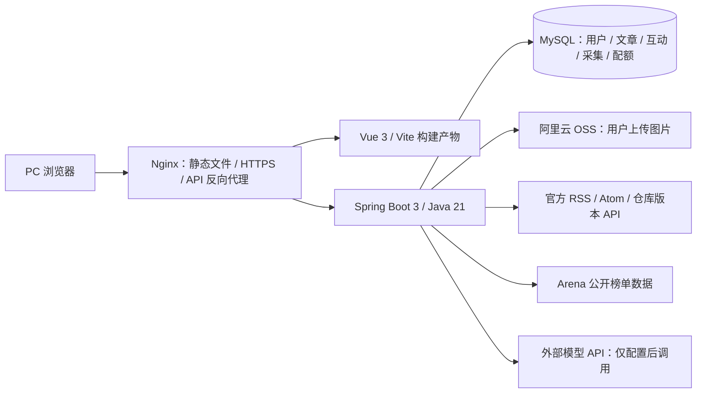

# BOOM 大事件：架构与演示路线

本页是项目当前的面试入口。后端仓库为 `big-event`，前端仓库为 [big-event-web](https://github.com/Wkey999/big-event-web)，目前持续开发的分支：后端 `master`，前端 `main`。项目面向 PC Web，移动端适配不属于当前初版目标。

## 一句话介绍

BOOM 是一个前后端分离的内容社区。用户可以浏览、检索、创作和互动；后台从限定的官方 RSS/Atom 与官方仓库版本源收录链接卡片；AI 助手通过只读工具查询已发布文章；模型榜单展示外部测评数据，不自行编造分数。

## 系统结构

浏览器请求以 `/api` 开头；开发环境由 Vite 代理剥离此前缀，服务器由 Nginx 反向代理剥离。Vue Router 使用 History 模式，页面刷新由 Nginx 回退到 `index.html`；缺失的静态资源仍返回 404。后端和 MySQL 只在服务器本机监听，不对公网开放业务端口。

## 面试演示顺序

1. 登录后展示首页频道、内容卡片、文章详情和点赞/收藏；说明互动关系存入 MySQL，重复操作幂等，计数与关系在同一事务中更新。
2. 用关键词搜索已发布内容，再展示 AI 搜索。AI 使用 `query_published_articles` 和用户本人画像工具读取站内数据；平台免费试用按账号、网络、全站三个维度在 MySQL 中限额，个人 API Key 只在当前请求使用。没有配置模型时，可以只演示普通检索和工具链代码，不宣称完成了模型实调。
3. 管理员展示资讯来源、采集记录和审核。仅指定官方来源允许自动发布链接卡片；其他来源需审核。平台保存标题、作者、时间和原文链接，不复制正文与配图。
4. 展示 AI 榜单的对话、编程建站、搜索、视觉和 Agent 五个维度，说明分数来自公开测评来源，页面显示来源和更新时间。若外部数据暂时不可用，应展示空态，不填充模拟分数。
5. 打开部署记录，说明单机 Nginx + systemd + MySQL、密钥外置、备份和回退。公网 IP 可能轮换，演示前应核对最新地址及 HTTPS 证书。

## 技术边界与下一步

- 已使用 MySQL 事务实现 AI 试用配额，点赞关系及冗余计数也在 MySQL 中维护。`pom.xml` 虽含 Redis 依赖，当前业务代码未实际调用 Redis；不能把它写成已落地的技术点。
- AI 检索当前是模型工具调用 + 站内关键词查询，不是向量 RAG。Embedding、分块、向量召回和对比评测均属待做实验。
- 当前线上使用本机 MySQL、Nginx 和 systemd；仓库尚无 Dockerfile / Compose，不应将线上部署描述为容器化。
- 旧 README 下方保留了按日期追加的实施记录，其中旧接口数量、旧测试数量、旧来源范围和旧公网地址可能已经过期。面试以运行中的功能、代码及本页为准。
